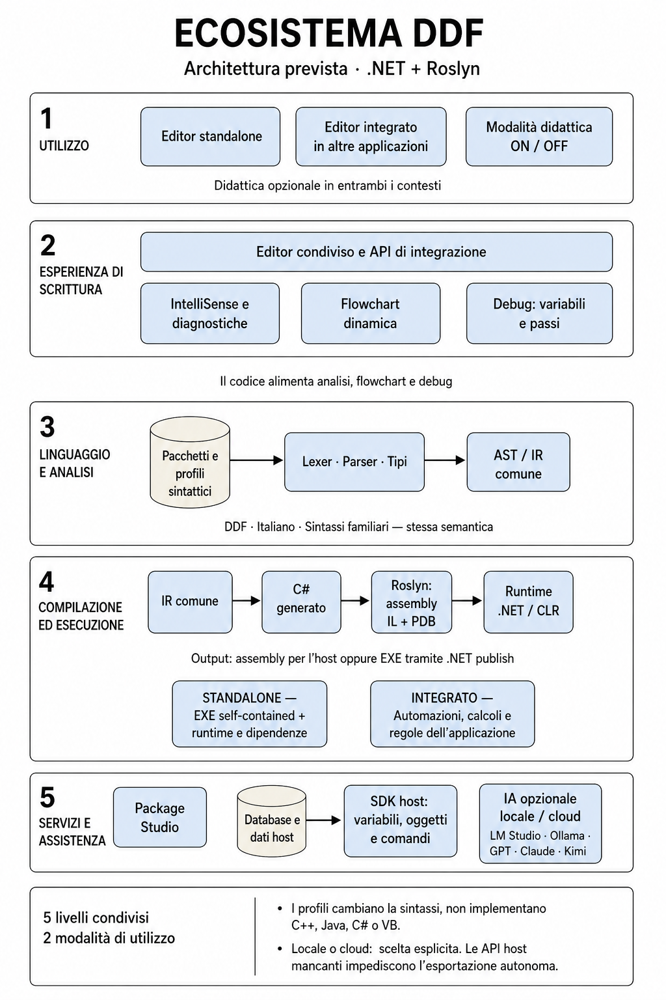

# Ecosistema DDF — architettura di destinazione

Decisione del 5 settembre 2026: .NET + Roslyn è il backend principale previsto.

Dal contratto DDF `0.12.2`, ogni tipo eseguibile deve avere un mapping CLR/C#
versionato e validabile da Roslyn. Il mapping non cambia la semantica DDF e non
concede accesso automatico al framework: overflow, non-null, bounds e capacità
host restano controllati dalla IR e dagli adapter autorizzati.
Il compilatore Roslyn appartiene esclusivamente allo standalone e alla relativa
CLI. Il componente embedded non genera né carica assembly DDF: interpreta sempre
lo script per espandere l'applicazione host attraverso capacità autorizzate.
Lo schema descrive il prodotto da costruire, non funzionalità già tutte disponibili.

## Vista a livelli

Tavola illustrativa generata con image generation integrata, ispirata al riferimento
di architettura e-learning fornito dall'utente. Specifica del prompt finale:
diagramma italiano a cinque livelli, blocchi azzurri e archivi cilindrici su fondo
bianco; mostrare utilizzo, editor, analisi, .NET/Roslyn e servizi; mantenere frecce
brevi nei flussi di analisi, compilazione e accesso dati, evitando collegamenti
tra livelli ambigui. La tavola è concettuale; il diagramma Mermaid seguente è
normativo e separa la compilazione standalone dallo scripting embedded.

## Dipendenze dei componenti

```mermaid
flowchart TB
    studio["Package Studio<br/>Creazione, test e distribuzione profili"]
    profiles["Profili sintattici<br/>DDF · Italiano · Sintassi ispirate a C / C# / Java / VB"]
    editor["Editor condiviso<br/>Standalone oppure componente incorporato"]
    teaching["Modalità didattica ON / OFF<br/>Sempre disponibile in entrambi i contesti<br/>Indipendente da lingua e profilo"]
    core["Core comune<br/>Lexer · Parser · Tipi · Semantica · AST / IR"]
    ide["Assistenza alla scrittura<br/>IntelliSense · Diagnostiche · Formatter · Outline"]
    chart["Flowchart dinamica<br/>Struttura · Navigazione · Nodo in esecuzione"]
    backend["Backend .NET<br/>IR → C# generato → Roslyn → Assembly IL + PDB"]
    runtime["Runtime .NET / CLR<br/>Esecuzione · Memoria · Librerie consentite"]
    debug["Debug del sorgente originale<br/>Mappe sorgente · Breakpoint · Variabili · Passi"]
    host["INTEGRATO<br/>Automazioni · Calcoli · Regole personalizzate<br/>Script sulle API dell'applicazione"]
    exe["STANDALONE<br/>Pubblicazione EXE self-contained<br/>Programma + runtime + dipendenze"]
    api["Contratto host / SDK<br/>Variabili · Oggetti · Database · Comandi<br/>Firme · Documentazione · Permessi"]
    plugins["Estensioni esplicite<br/>Nuove capacità e integrazioni autorizzate"]
    vm["VM DDF attuale<br/>Riferimento durante la transizione"]
    ai["Assistente IA opzionale<br/>Proposte · Spiegazioni · Test · Didattica"]
    providers["Adapter IA locali o cloud<br/>Fornitore e modello scelti esplicitamente"]
    studio --> profiles
    providers <--> ai
    core -->|contesto selezionato e diagnostiche| ai
    api -->|catalogo autorizzato| ai
    ai -->|anteprima da convalidare e approvare| editor
    profiles --> editor
    teaching -.->|presentazione e spiegazioni| editor
    teaching -.->|supporti didattici| chart
    profiles --> core
    editor -->|sorgente| core
    core --> ide
    ide -->|feedback| editor
    core --> chart
    core --> backend
    core -.-> vm
    backend --> runtime
    backend -->|SDK .NET publish| exe
    exe -->|esecuzione autonoma| runtime
    vm -->|scripting interpretato| host
    api --> ide
    api -->|tipi e operazioni disponibili| core
    api -->|binding autorizzati| vm
    plugins -.-> api
    backend -->|mappe e punti di controllo| debug
    runtime -->|stato di esecuzione| debug
    debug -->|pausa e avanzamento| runtime
    debug --> editor
    debug --> chart
```

## Come si usa

- Integrato: l'applicazione incorpora il controllo, registra oggetti e operazioni
  e decide persistenza, permessi e modalità di esecuzione. Lo script interpretato
  amplia l'applicazione attraverso quel contratto; non viene compilato in un
  assembly e non espone comandi di compilazione o pubblicazione.
- Standalone: l'autore scrive e prova il programma, poi lo pubblica per un sistema
  e un'architettura specifici. L'EXE si avvia senza l'editor; inizialmente possono
  essere necessari file di supporto nella stessa distribuzione.
- Didattica: opzione sempre attivabile e disattivabile nell'editor standalone e
  integrato, con qualsiasi lingua o profilo sintattico. Aggiunge presentazione e
  spiegazioni didattiche senza cambiare programma, permessi o build. Flowchart e
  debugger restano disponibili anche fuori da questa modalità. Il diagramma
  deriva dall'analisi, non esegue codice mentre l'utente scrive e rimane in sola
  lettura: modificare graficamente nodi o collegamenti non riscrive il sorgente.

Il caso dimostrativo prioritario è un'applicazione che legge dati da un database
di prova tramite un servizio host, espone variabili e funzioni allo script e
riceve risultati da un algoritmo personalizzato. Le procedure possono essere
richiamate da un pulsante o da eventi dell'applicazione, con parametri e risultati
tipizzati. L'accesso ai database passa da query parametrizzate e transazioni
controllate dall'host; le credenziali non fanno parte del pacchetto sintattico.
CAD e SCADA sono soltanto esempi possibili, senza obiettivi di certificazione
settoriale. Il prodotto mira allo scripting incorporabile di uso generale.

Il comando On/Off resta raggiungibile anche quando l'applicazione ospitante
personalizza la shell. Lo SDK espone proprietà, comando ed evento di cambio;
la preferenza è persistita per contesto senza influenzare altre istanze.
La commutazione conserva testo, selezione, Undo e stato del debugger e non avvia
il programma. Gli EXE esportati non incorporano automaticamente l'interfaccia didattica.

## Stato e milestone

| Componente | Stato |
| --- | --- |
| Editor desktop, pacchetti, analisi e IR | Base implementata nella 0.9.6.7 |
| VM DDF e primo debug | Implementati con limiti beta |
| Variabili e passo-passo | 0.10.0–0.10.1 |
| Runtime multi-file | 0.11.0, completato |
| Flowchart dinamica | 0.11.1, completata |
| Controllo incorporabile e SDK host | 0.11.2, completati |
| DDF formale e corpus di profili equivalenti | 0.12.x, pianificati |
| Backend Roslyn, assembly, CLI ed EXE | 0.13.x, pianificati |
| Package Studio | 0.14.x, pianificato; gestione pacchetti e playground già presenti |
| SDK e host per plug-in installabili | 0.15.x, pianificati |
| Assistente IA locale/cloud e adapter | 0.16.x, pianificati |

## Contratti da preservare

L'assistente IA è opzionale, utilizzabile in standalone e integrato e separato
dalla compilazione .NET/Roslyn. Potrà usare server locali (ad esempio LM Studio
o Ollama) oppure servizi cloud (ad esempio GPT/OpenAI, Claude/Anthropic,
Kimi/Moonshot) mediante adapter con capacità esplicite. Queste integrazioni sono
pianificate. Il fornitore attivo e il contesto trasmesso saranno visibili; il
passaggio da locale a cloud richiederà una scelta esplicita. Credenziali e dati
host saranno gestiti separatamente dal codice e dai pacchetti.

Le proposte IA passano da anteprima, validazione del linguaggio e applicazione
annullabile; l'esecuzione richiede comandi autorizzati. La flowchart continua a
derivare dal codice. L'assenza del servizio IA non blocca editing, build o debug.

I profili personalizzano la sintassi del linguaggio comune; non implementano i
linguaggi di cui ricordano la scrittura. Selezionare un profilo non converte un
documento. Tradurre tra profili richiederà un comando esplicito e controlli di
compatibilità.

Nello standalone il backend genera C# dalla IR, conservando le regole del DDF.
Roslyn compila quel C# e il CLR esegue gli assembly. Nell'embedded la VM esegue
invece il sorgente come script e attraversa esclusivamente il catalogo host.
IntelliSense e flowchart si basano sul modello
originale. Il debugger richiede mappe sorgente e un meccanismo esplicito per pausa,
avanzamento e snapshot: non viene fornito automaticamente da Roslyn.

La VM attuale serve per confrontare i risultati durante la migrazione. Mantenerla
successivamente richiederà una decisione motivata e test di equivalenza continuativi.

Il collegamento iniziale risolve moduli e riferimenti tra assembly .NET. Non
richiede un linker nativo sviluppato internamente. Native AOT resta opzionale,
soprattutto per programmi esportati con dipendenze note.

Uno script dipendente dalle API di un host può diventare autonomo solo quando
esistono implementazioni distribuibili di tutte le API richieste. Il catalogo
autorizzato non costituisce da solo una sandbox: codice non fidato richiede
un processo worker separato, un protocollo IPC ristretto, limiti del sistema
operativo e la possibilità di terminare l'intero processo. Nel percorso
in-process le operazioni host ricevono token e scadenze cooperative, hanno budget
di chiamate e risorse e rilasciano deterministicamente le risorse registrate, ma
un delegate nativo o sincrono che ignora la cancellazione non può essere fermato
con garanzie. Undo del testo e rollback degli effetti
sull'applicazione sono contratti distinti; transazioni ed errori parziali vanno
gestiti esplicitamente dall'host.

## Riferimenti tecnici e licenze

- [API Roslyn](https://learn.microsoft.com/en-us/dotnet/csharp/roslyn-sdk/).
- [Licenze e redistribuzione .NET](https://github.com/dotnet/core/blob/main/license-information.md).
- [Condizioni dei binari .NET Windows](https://dotnet.microsoft.com/en-us/dotnet_library_license.htm).
- [Limiti Native AOT](https://learn.microsoft.com/en-us/dotnet/core/deploying/native-aot/#limitations-of-native-aot-deployment).

La distribuzione includerà le licenze e gli avvisi dei componenti effettivamente
usati; l'uso di .NET non rende automaticamente uniformi le licenze delle librerie.
